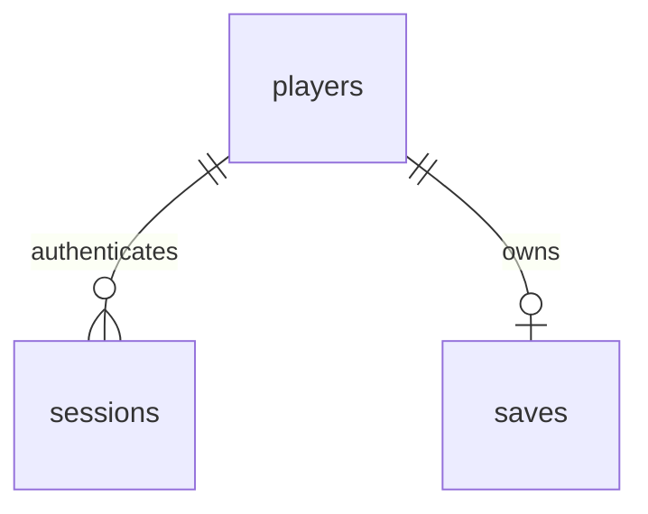

# API and database reference

Service: `backend/main.py`, FastAPI 0.115.12. Tài liệu tương tác `/docs`. JSON requests; lỗi dùng `{"detail": ...}`. Bearer token từ login, hết hạn sau 86400 giây. Tất cả tài khoản/saves thật được DB lưu; game browser không tự kết nối API này.

| Method/path | Auth | Input / output | Errors |
| --- | --- | --- | --- |
| GET /health | No | DB probe → status ok | DB failure → server error |
| GET /api/version | No | version/stage/simulation/frontend_mode | — |
| POST /api/auth/register | No | username,password → id,username (201) | 409 duplicate, 422 validation, 429 rate limit |
| POST /api/auth/login | No | username,password → access_token,token_type,expires_in | 401 invalid,422,429 |
| GET /api/player/profile | Bearer | id,username | 401 |
| PUT /api/player/save | Bearer | schema=deep-command-v1,state object → status,updated_at | 401,413 encoded >2MB,422 version |
| GET /api/player/save | Bearer | saved JSON envelope | 401,404 |
| DELETE /api/auth/logout | Bearer | revoke token; 204 | 401 |

Username: 3–40 ASCII letters/digits/_/-, case-insensitive storage. Password: 10–128 characters. Unknown fields rejected by auth model. PUT save is a storage API with basic envelope/version validation, not full authoritative simulation validation. Full frontend import validation happens in `restore`.

## ORM

| Table | Columns | Constraints |
| --- | --- | --- |
| players | id varchar64, username varchar40, password_hash varchar256 | id PK; username unique indexed |
| sessions | token_hash varchar64, player_id varchar64, expires datetime timezone | token_hash PK; player_id FK players.id indexed |
| saves | player_id varchar64, payload text, updated_at datetime timezone | player_id PK/FK players.id; one slot per account |

Initial schema only: `backend/init_db.py` executes metadata.create_all. No Alembic migrations yet. SQLite tests use StaticPool memory DB; PostgreSQL schema/config exists but runtime not verified. Database payloads are private to authenticated owner. Expired sessions denied; no scheduled cleanup yet. API request body size is checked after Pydantic parse; production reverse proxy must cap total request size. Add edge/distributed rate limits, TLS, migrations, observability and backup automation before exposing service publicly.
