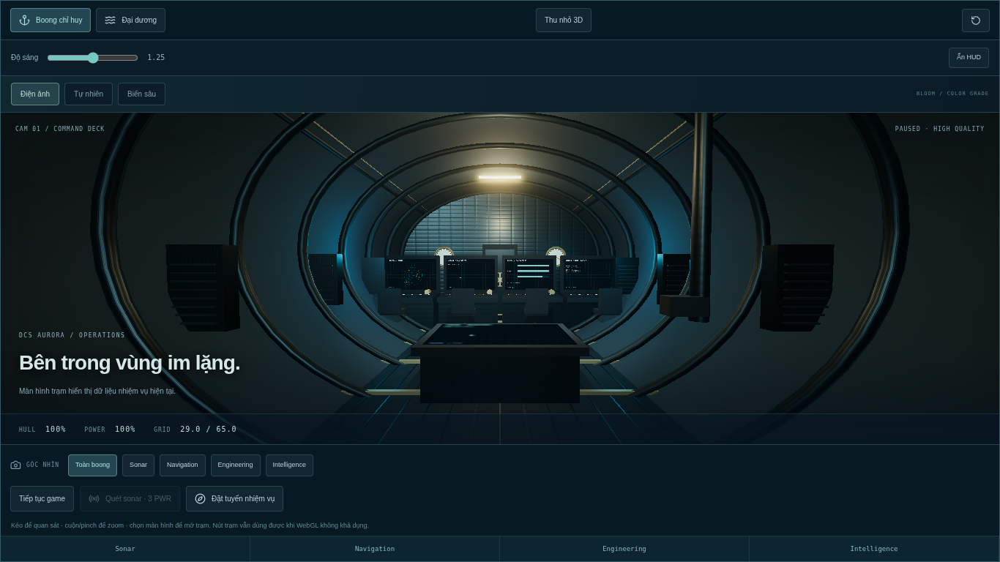
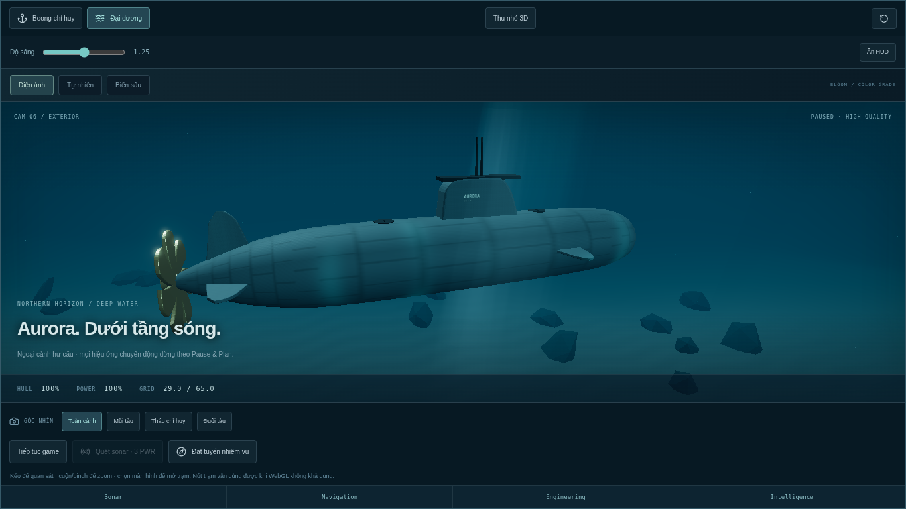
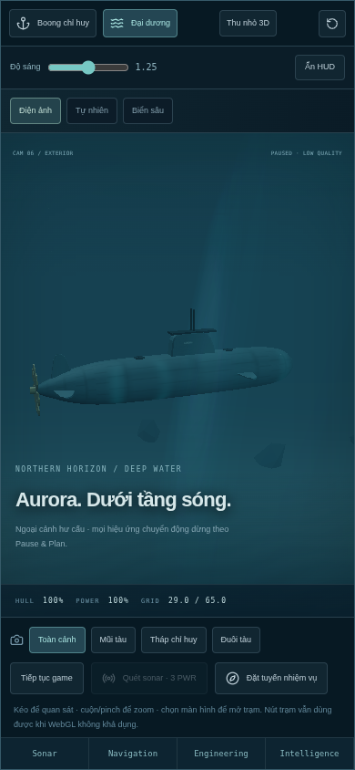
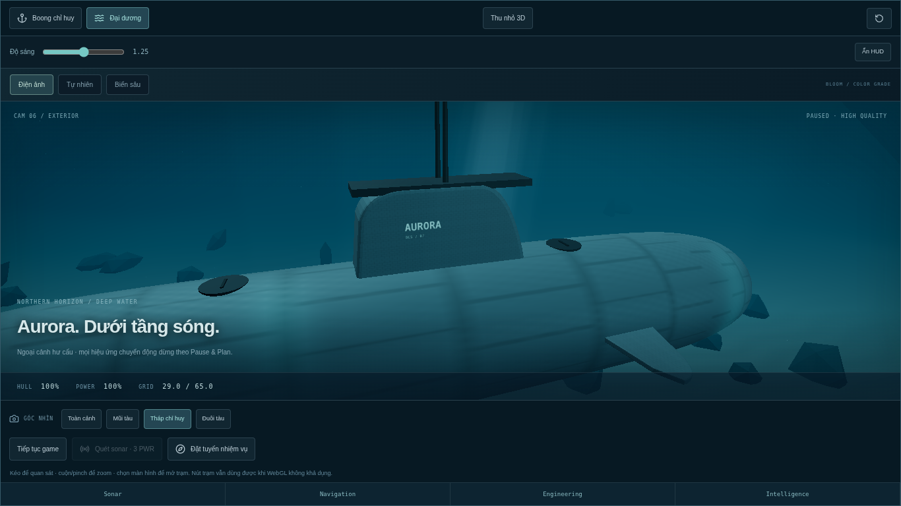

# Browser QA — updated 2026-11-14 / live 0.9.0 and candidate 0.9.2

These are actual browser runs, not DOM mocks. Playwright 1.62.1 controlled installed Chromium 156.0.8078.79, headless with ANGLE/SwiftShader software WebGL. TLS verification remained enabled and the managed proxy/CA configuration was retained.

## Live deployment

URL: https://tank.daitan.site. API metadata returned 0.9.0. A new isolated browser profile was used. No production accounts were registered and no backend save data was written.

The five missions were played through real UI controls with Playwright's controlled clock accelerating browser timers. Every mission reached grade S; campaign/best records were saved to that profile's localStorage, reloaded and restored. Controlled time is not a wall-clock/FPS benchmark.

A pointer interaction defect was reproduced: clicking the center of a contact group's bounding box could fall through a gap between the diamond and SVG text onto the map's restricted-sector ellipse. The live playthrough continued via the already-supported Enter key for contact selection in Final Order. Candidate tests require mouse selection and pass. Also observed: missing /favicon.ico (404), dark deck fill, hard-edged light shafts and a narrow viewport cropping the exterior hull.

Live deck and ocean both rendered with no JavaScript/shader errors in the tested route; the known favicon request was reported separately. Live visuals are the old build until the owner deploys the candidate.

## Candidate verification (0.9.1 baseline, repeated for 0.9.2)

- Full 5-mission UI playthrough, all grade S, with mouse contact selection and persisted reload.
- Deck and ocean rendered at 1366×768 high, 1920×1080 high and 390×844 low; WebGL2 available and getError() returned 0 for each sampled canvas.
- Screenshots were inspected: softer shafts, reduced reflected stripes, increased fill and a closer exterior frame. Portrait framing was subsequently adjusted to fit both ends of the hull.
- A real click on the navigation console after its camera preset opened the Navigation screen at each viewport.
- WEBGL_lose_context was injected in the 1366 viewport; Reload 3D created a new functioning renderer.
- No unexpected page/console errors or HTTP failures in the candidate suite. No horizontal overflow detected after returning to the map.
- Immersive view removes the page footer from the scene area; DOM tests cover Escape/focus semantics. Pause/resume is available inside the viewer.

The browser test runs in CI, saving screenshots/report as the browser-evidence artifact. Local successful reports and screenshots are generated under test-results/browser by default. Each isolated profile is discarded after testing.

## 2026-11-14 follow-up

Live API metadata still reports 0.9.0. Fresh query/no-cache requests returned the same index-R-elXO7b.js and index-r5Cnd1b0.css assets with Cloudflare DYNAMIC status; this was not merely an old local browser profile. The frontend still lacks Phóng to 3D and shows the old narrow exterior camera/hard light shafts, independently confirming the earlier viewer remains deployed. A fresh isolated run rendered deck/ocean at all three viewports, physically clicked the navigation console, and returned without overflow. The known old favicon 404 remains; no unexpected JS/shader or HTTP errors occurred. This follow-up was graphics-only on production; the five-mission live campaign result above belongs to 2026-11-13.

Local 0.9.2 repeated all five missions via mouse, all grade S, and restored the final saved campaign. Graphics checks cover 1366×768 high, 1920×1080 high and 390×844 low, picking and one injected context recovery. Browser automation additionally captured bow, sail and stern presets and all three looks at 1366×768. No unexpected console/page/HTTP errors; WebGL2 getError()=0 at the sampled checks. The final low-quality backdrop material correction was followed by a fresh graphics sweep; campaign logic was unchanged.

Inspected images show lower-contrast hull tiles, curved control surfaces, sail lettering, dorsal hatches and a continuous fog background. Far terrain and background share the current look tint; backdrop skips per-material tone mapping in direct/low mode because Three's fog is mixed after that stage. High mode maps both through OutputPass. Portrait framing retains the whole hull.

The runner now records viewport width/height separately from bufferWidth/bufferHeight. Earlier reports overwrote viewport dimensions with canvas buffer dimensions; screenshot filenames still correctly identified the test viewport.

## Candidate screenshots

Captured from the locally served candidate, not the production domain. The screenshots below are from the 0.9.2 local candidate, including the exterior material/geometry and fog/backdrop refinements; CI artifacts also capture the build under test.









## Reproduce

```bash
npm ci
npx playwright install --with-deps chromium
npm run build
npm run test:browser
```

When system Chromium is already installed, set PLAYWRIGHT_CHROMIUM_EXECUTABLE to its path. For an approved live smoke run, set BROWSER_TEST_URL to the site. BROWSER_BASELINE_KEYS=1 is only for examining the old contact hit-area issue; normal CI does not set it. BROWSER_CAMPAIGN_ONLY/BROWSER_VISUALS_ONLY allow focused reruns; default CI runs both.

## Limits

Software WebGL verifies these shader/render/control paths but does not establish discrete-GPU FPS, memory behavior over long sessions, Safari/Firefox/Edge compatibility or performance on physical mobile devices. Portrait viewport coverage is not a real phone benchmark. Cloud login/upload on production was not exercised; separate API/HTTP/PostgreSQL tests cover that boundary in disposable QA. Context recovery was checked in one desktop viewport, not every device.
