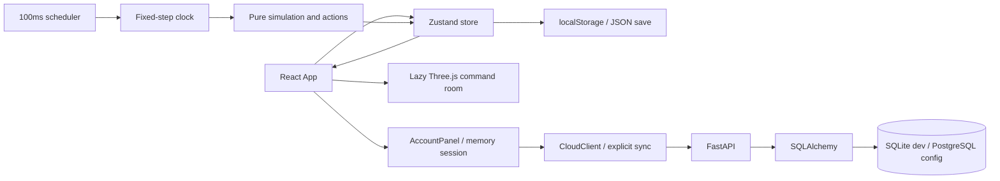

# System architecture

Giao diện gọi API qua AccountPanel/CloudClient khi VITE_API_URL được cấu hình. Cloud chỉ chạy theo thao tác lưu/tải có xác nhận; autosave vẫn local. Nguồn truth runtime là `State` trong Zustand. UI gọi `dispatch` → clone state → `act`; scheduler gọi `advance` → `SimulationClock` → `step`. Render không chạy logic nhiệm vụ. Timestep 1 giây game, accumulator nhân tốc độ, delta bị chặn 0.5 giây để tránh catch-up vô hạn khi tab bị treo. Tab background không được bảo đảm thời gian thực.

PRNG LCG lưu seed trong state. Cùng state và cùng chuỗi lệnh/tick cho cùng kết quả. Khi paused/planning, clock xóa phần tick lẻ. Save không lưu phần tick dưới một giây, vì vậy resume có thể lệch dưới một giây so với wall time; state game đầy đủ được khôi phục. Import/load luôn paused.

Save schema `deep-command-v1` chứa state, campaign, resources, crew, contacts, intel, log, settings. `restore()` kiểm tra trường/biên chính trước khi gán. Không dùng save client làm dữ liệu đáng tin cậy cho multiplayer/leaderboard. Autosave 15 giây; thất bại lưu có toast. Source filename/schema version phải thay đổi có migration khi cấu trúc save đổi.

Map SVG tương tác có transform pan/zoom, điểm chọn đổi từ screen sang SVG rồi nghịch đảo transform. Marker nhận pointer riêng. Các lớp trang trí có toggle. Boong WebGL lazy-loaded, cleanup animation frame, observer, listeners, geometry/material/renderer khi unmount. Cảnh chưa kiểm thử trực quan.

Backend có auth scrypt với random salt, token opaque lưu SHA256 phía server, TTL 24h, query save ràng buộc player. CORS dùng allowlist. Rate limit auth là per-process. UI luôn nhãn local simulation để tránh hiểu nhầm dữ liệu API.

## Cloud save v0.2

CloudClient giữ token và profile trong bộ nhớ, tự xóa phiên khi HTTP 401. API calls có timeout 12s; UI có busy/error/success và không ghi đè tự động khi lỗi. Khi mở tài khoản từ game đang chạy, game tạm dừng; đóng tài khoản không tự resume. Session không được đưa vào state/save/localStorage.

GET save trả envelope v1 + `revision` (UTC timestamp chuẩn hóa). PUT nhận `expected_revision`; cập nhật theo compare-and-swap nguyên tử với giá trị `updated_at` cũ. Race tạo bản lưu đầu tiên bắt IntegrityError; conflict trả 409. Không thay DB schema, không đổi offline save schema. Client cũ không gửi revision sẽ bị chặn khi ghi đè save có sẵn: cần nâng frontend cùng API.

Trước khi tải cloud/import, frontend validate save rồi ghi backup, ghi save mới, cuối cùng mới thay Zustand state. Lỗi storage giữ nguyên game đang chơi. Backup một slot theo origin, không phải version history toàn bộ. Xem CLOUD_SAVE.md.

## Campaign build 0.9

State has additive Career data: attempt count, best result per mission, purchased research IDs. Legacy v1 restores receive empty Career defaults; existing XP/completions/resources remain. Incident.response optionally stores crew repair remaining ticks. All rank/unlock calculations and resource/job decisions remain in career.ts/simulation.ts, not React.

CampaignPanel opens preflight station access without starting simulation. Main UI's preparation flag is ephemeral; only explicit Start advances the briefing. Selecting an unlocked mission confirms and persists a checkpoint before dispatch. Store resets clock fractions on mode/deployment changes and immediately saves the first debrief transition. Failed disk writes retain the completed game in memory and expose saveError.

Graphics source is split into lazy viewer/effects/engine chunks. HTTP deployment smoke tests fetch every chunk; a main-page 200 alone is not a complete asset check. Real GPU/browser verification remains absent.
